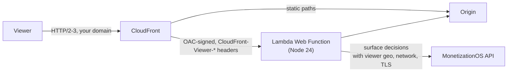

<div align="center">
  <a href="https://monetizationos.com">
  
  </a>
  <h1>MonetizationOS AWS Lambda Proxy</h1>
</div>

[MonetizationOS](https://monetizationos.com) powers monetization for human and bot users alike. Use this [AWS Lambda Web Function](https://docs.aws.amazon.com/lambda/latest/dg/web-functions.html) behind Amazon CloudFront to proxy your website and integrate MonetizationOS Surfaces, enabling seamless monetization experiences for sites served with static HTML.

This proxy includes handling for both HTTP response modification and CSS-targeted Components for content modifications including: removal/truncation, displaying offerings, and custom messaging.

The shared proxy pipeline is provided by [`@monetizationos/proxy`](https://www.npmjs.com/package/@monetizationos/proxy). This repository contains the Node server Lambda runs, environment variable mapping, CloudFront-specific adapters for HTML rewriting and request metadata, and the CloudFormation stack. It behaves like our [Cloudflare proxy worker](https://github.com/MonetizationOS/cloudflare-proxy-worker), whose test suite runs against it unchanged.

Read more about using MonetizationOS at [docs.monetizationos.com](https://docs.monetizationos.com).

## Getting Started

You need:

- An AWS account and the AWS CLI v2, with `aws lambda-web` support.
- Node.js 24, [pnpm](https://pnpm.io/), `zip`, `shasum` and `openssl`.
- An S3 bucket for code, with versioning enabled and a bucket policy that grants `lambda.amazonaws.com` `s3:GetObject` and `s3:GetObjectVersion`, conditioned on `aws:SourceAccount` being your account.

Then deploy the stack:

```sh
pnpm install
STACK=mos-proxy CODE_BUCKET=my-code-bucket ORIGIN_URL=https://origin.example.com \
  MOS_SECRET_KEY=sk_... infra/deploy.sh
```

The script builds the proxy, uploads it, deploys [`infra/template.yaml`](infra/template.yaml) and prints the CloudFront URL. Deploy in the AWS Region nearest your origin: each page waits on your origin and then on MonetizationOS.

To serve your own domain, add `Aliases` and an ACM certificate from us-east-1 to the distribution.

## Required Variables

The proxy reads the same variables as the Cloudflare worker, from the Web Function revision's environment. The template sets each one from a stack parameter. These have no default:

- `MONETIZATION_OS_SECRET_KEY` (`MosSecretKey`): Your MonetizationOS secret key. [Get your secret key](https://docs.monetizationos.com/docs/guides/environments/managing-environments#api-keys).
- `ORIGIN_URL` (`OriginUrl`): The origin URL for your proxied website, as `https://host[:port][/path]`.

## Variables with Defaults

The defaults below are the template's:

- `SURFACE_SLUG` (`SurfaceSlug`): The slug for the MonetizationOS surface you want to target. Defaults to `web`.
- `AUTHENTICATED_USER_JWT_COOKIE_NAME` (`AuthenticatedUserJwtCookieName`): Cookie name for authenticated user JWT sessions. Defaults to `__session`.
- `ANONYMOUS_SESSION_COOKIE_NAME` (`AnonymousSessionCookieName`): Cookie name for anonymous sessions. Defaults to `anon-session-id`.
- `INJECT_SCRIPT_URL` (`InjectScriptUrl`): URL of the MonetizationOS web components script. Empty by default, so nothing is injected. Set it to `https://assets.monetizationos.com/web-components-latest.js` to use MonetizationOS web components. The proxy adds it to `<head>` only on pages where a component transform runs.
- `MONETIZATION_OS_HOST` (`MosHost`): MonetizationOS API host. Defaults to `https://api.monetizationos.com`.
- `MONETIZATION_OS_ENDPOINTS_PREFIX` (`MosEndpointsPrefix`): Path prefix for proxied custom endpoints. Defaults to `/mos-endpoints/`.

## Stack Settings

These template parameters configure the stack rather than the proxy:

- `MaxEnvironments`: An optional cap on the execution environments the endpoint runs at once, from 2 to 10,000. Defaults to `0`, which leaves it uncapped, so only the account's Web Functions vCPU quota bounds scaling (2 vCPUs per environment). At the cap, Lambda answers further requests with 429 instead of scaling, so set one only to bound the cost of a test stack.
- `LogRetentionInDays`: How long CloudWatch keeps the proxy's logs. Defaults to `14`. It applies to both log groups the stack owns: `/aws/lambda/web/<stack>-proxy.local`, which environments write to, and `/aws/lambda/web/<stack>-proxy`, which Lambda copies them into. Deleting the stack deletes both.

`infra/deploy.sh` reads these shell variables and passes each on as a stack parameter:

| Variable | Parameter |
| --- | --- |
| `ORIGIN_URL` | `OriginUrl` |
| `MOS_SECRET_KEY` | `MosSecretKey` |
| `ORIGIN_AUTH` | `OriginAuth` |
| `SURFACE_SLUG` | `SurfaceSlug` |
| `MOS_HOST` | `MosHost` |
| `INJECT_SCRIPT_URL` | `InjectScriptUrl` |
| `MAX_ENVIRONMENTS` | `MaxEnvironments` |
| `LOG_RETENTION_IN_DAYS` | `LogRetentionInDays` |

Pass any other parameter as an argument, e.g. `infra/deploy.sh AnonymousSessionCookieName=my-anon`. A parameter left out keeps its current value, so `MOS_SECRET_KEY` is only required for a new stack.

Secret parameters are `NoEcho`, so CloudFormation doesn't display them, but they are stored as revision environment variables and CloudFront origin headers. Anyone who can read the Web Function or distribution configuration can read them.

## Optional: paths that skip surface decisions

`SURFACE_DECISIONS_IGNORE_PATHS` is a comma-separated list of regular expressions. Matching pathnames still proxy to the origin and rewrite origin links, but skip MonetizationOS surface decisions and component transforms.

## Optional: cookies forwarded to surface decisions

`SURFACE_DECISIONS_COOKIES` is a comma-separated list of regular expressions. Cookie names matching any pattern are forwarded to the MonetizationOS surface-decisions API as `http.cookies`. Matching cookies are read from the incoming request `Cookie` header and from the origin response `Set-Cookie` headers; when the same name appears in both, the origin value is used. When unset or when no cookies match, `http.cookies` is omitted from the surface-decisions payload.

Neither has a template parameter. Add them to the revision's `EnvironmentVariables` in `infra/template.yaml`:

```yaml
SURFACE_DECISIONS_COOKIES: "^__session$, ^theme$, ^mos_"
```

Each pattern is a regex tested against the cookie **name**. Plain names like `^__session$` match exactly; prefixes like `^mos_` match any cookie whose name starts with `mos_`.

## Optional: headers sent to the origin

`ORIGIN_REQUEST_HEADERS` (`OriginRequestHeaders`) adds or overrides outgoing headers on every upstream fetch to `ORIGIN_URL`. Set it to a JSON object mapping header names to values. Leave it as `{}` when no extra headers are needed. Setting it turns off [static paths straight to the origin](#optional-static-paths-straight-to-the-origin), since CloudFront can't add these headers.

```sh
infra/deploy.sh 'OriginRequestHeaders={"X-Api-Key": "secret", "X-Custom": "my-value"}'
```

## Optional: static paths straight to the origin

The proxy passes non-HTML responses through untouched, so CloudFront sends paths ending in a static file extension straight to `ORIGIN_URL` and skips Lambda. This keeps assets off the endpoint's request rate and environments. The `StaticExtensions` stack parameter lists the extensions, matched case-insensitively. It defaults to `css,js,mjs,map,png,jpg,jpeg,gif,webp,avif,svg,ico,woff,woff2,ttf,otf,eot,mp4,webm,mp3,wasm`. Paths under `MONETIZATION_OS_ENDPOINTS_PREFIX` always go to the proxy. Set it to an empty string to send every path through the proxy, for example when the origin only accepts requests from the proxy.

```sh
infra/deploy.sh StaticExtensions=css,js,png,jpg,woff2
```

CloudFront doesn't cache these requests either, so put your origin behind its own CDN. See [origin caching](#how-it-works).

## Optional: origin auth

The `OriginAuth` stack parameter, set by `deploy.sh` from `ORIGIN_AUTH`, controls how the Lambda endpoint keeps out requests that don't come through CloudFront. The proxy doesn't read it.

- `IamAuth` (default for new stacks): CloudFront signs each request with Origin Access Control, and Lambda rejects anything else. A shared secret, `x-mos-origin-verify`, is checked as well.
- `ApplicationManaged`: The endpoint is public, and only the shared secret keeps direct callers out.

The deploy script generates the secret on the first deploy and keeps it on later ones, as the `OriginVerifySecret` parameter. The template passes it to the proxy as `ORIGIN_VERIFY_SECRET`. When unset, as in local development, the proxy skips the check. The proxy answers a request without the right value with a 403, and removes the header before requests reach your origin.

## How it works



- **CloudFront** terminates TLS on your domain and forwards requests uncached, with its viewer location, network and TLS headers.
- **Forwarded host headers.** The CloudFront Function and the proxy drop any `X-Forwarded-Host` or `Forwarded` header the viewer sends, so an origin that builds URLs from them can't be pointed at another host.
- **Static paths.** The CloudFront Function sends paths with a [static extension](#optional-static-paths-straight-to-the-origin) to the origin, without signing or `x-mos-origin-verify`.
- **Viewer headers.** Lambda only accepts its own domain as `Host`, so a CloudFront Function copies the viewer's into `x-mos-viewer-host`, and returns 400 when the viewer sent none. The proxy uses it to rebuild the public URL and rewrite origin links. The function also copies `Accept-Encoding` into `x-mos-accept-encoding`, or sets `identity` when the viewer sent none, which the proxy uses to choose the response encoding.
- **HTML rewriting** uses [lol-html](https://github.com/cloudflare/lol-html), the engine behind Cloudflare's `HTMLRewriter`, built to WASM. See [`vendor/lol-html`](vendor/lol-html).
- **Origin caching.** Nothing between the viewer and your origin caches: decisions are per viewer, so CloudFront can't cache pages, and neither Lambda nor Node's `fetch` caches the proxy's origin requests. Put your origin behind its own CDN with cacheable responses, so the proxy's fetches, and the [static paths](#optional-static-paths-straight-to-the-origin) CloudFront sends straight there, are served from that CDN's edge rather than your servers.
- **Compression.** The proxy compresses text responses with brotli or gzip, flushing per chunk so streamed responses keep streaming.
- **Concurrency.** The template sets `MaxConcurrencyPerEnvironment` to 32. Each environment runs one event loop, so throughput is bound by CPU per page: past about 32 requests in flight, a 300 KB page mostly queues. Tune it from your own load tests.

### Viewer data sent to MonetizationOS

The proxy calls the MonetizationOS API from an AWS Region, so the connection carries that Region's location and network, not the viewer's. The proxy sends the viewer's, from CloudFront's headers, in the generic CDN `edge` request body:

| `edge` field | CloudFront source |
| --- | --- |
| `provider` | `cloudfront` |
| `requestId` | `X-Amz-Cf-Id` |
| `geo.countryCode` | `CloudFront-Viewer-Country` |
| `geo.regionCode` | `CloudFront-Viewer-Country-Region` (ISO 3166-2 subdivision) |
| `geo.region` | `CloudFront-Viewer-Country-Region-Name` |
| `geo.city` | `CloudFront-Viewer-City` |
| `geo.postalCode` | `CloudFront-Viewer-Postal-Code` |
| `geo.metroCode` | `CloudFront-Viewer-Metro-Code` (US only) |
| `geo.latitude`, `geo.longitude` | `CloudFront-Viewer-Latitude`, `CloudFront-Viewer-Longitude` |
| `geo.timezone` | `CloudFront-Viewer-Time-Zone` (IANA) |
| `network.asn` | `CloudFront-Viewer-ASN` |
| `tls.version` | `CloudFront-Viewer-TLS` |
| `tls.httpProtocol` | `CloudFront-Viewer-Http-Version`, e.g. `HTTP/2` |

The body is sent even when CloudFront can't geolocate the viewer. CloudFront doesn't provide the continent, AS organisation, proxy type, HTTP/2 fingerprint or a bot verdict. JA3 and JA4 fingerprints aren't sent: the managed origin request policy, which the endpoint needs because it removes the viewer's `Host`, can't forward them.

The viewer's IP address, from `CloudFront-Viewer-Address`, is sent as `http.clientIP`.

## Commands

- `pnpm start`: Run the built proxy locally.
- `pnpm build`: Bundle the proxy into `build/`, the root of the deployment zip.
- `pnpm test`: Run the Cloudflare worker's test suite against the Node server with Vitest.
- `pnpm e2e`: Build, then run the bundle as Lambda would against a fake origin and API.
- `pnpm typecheck`: Type-check with TypeScript.
- `pnpm lint`: Run lint checks with Biome.
- `pnpm format`: Apply Biome's formatting and safe fixes.

## Local Development

1. Install dependencies:
    ```sh
    pnpm install
    ```
2. Build and start the proxy against your origin:
    ```sh
    pnpm build
    AWS_LAMBDA_HTTP_ENDPOINT=127.0.0.1:8787 ORIGIN_URL=https://origin.example.com MONETIZATION_OS_SECRET_KEY=sk_... \
      SURFACE_SLUG=web ANONYMOUS_SESSION_COOKIE_NAME=anon-session-id AUTHENTICATED_USER_JWT_COOKIE_NAME=__session pnpm start
    ```

## Deployment

Redeploy after changes with the command from [Getting Started](#getting-started). The stack keeps its secret key, so `MOS_SECRET_KEY` can be left out:

```sh
STACK=mos-proxy CODE_BUCKET=my-code-bucket ORIGIN_URL=https://origin.example.com infra/deploy.sh
```

Each deploy uploads a new zip and publishes a new Web Function revision.

## License

[MIT](LICENSE)
